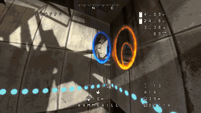

# Portal 2 FPV

<p></p>

Fly a real FPV quadcopter through Aperture's test chambers with your own radio,
and solve them with it: fire portals from the drone, press buttons, carry
cubes to buttons, fly through your portals with all your momentum, ride faith
plates and excursion funnels, and dodge turrets, lasers, fizzlers and goo.

The drone is [libfpv](https://github.com/hammerill/libfpv): real Betaflight
firmware in the loop, a Betaflight OSD, the fisheye of an FPV camera, motor
sound, and an F8 overlay with a radio setup wizard.

> **Status:** in development. Tested in game (Windows): flight, cameras,
> portals, use, grab, buttons, lasers, turrets, faith plates, funnels,
> fizzlers and goo. Gel isn't in yet.

## Features

- **Fly it like a real quad.** Radio (USB joystick mode), gamepad or keyboard.
  Betaflight rates, modes and tune; Betaflight Configurator connects too.
- **The drone is the portal gun.** Blue and orange portals fire along the
  drone's camera with the gun's own rules (portalable surfaces, fizzlers, room
  to fit), but only the colours Chell's gun has at that point of the game.
- **Through the portals.** The drone keeps its speed and spin through a
  portal pair, turned with it: dive into a floor portal, fly out of the wall.
- **Hands on the sticks.** Fire, use and grab go on your radio's switches
  and buttons (F8 > Radio > Set up game controls), next to the flight modes.
- **Use and grab.** Press pedestal buttons from the air; hook a cube (or a
  turret) under the drone: it hangs on a winch line, swings with every turn
  and weighs on the motors. Lower it onto a button and let go.
- **The chamber fights back.** Turrets shoot the drone, lasers burn its
  props, goo and water drown it, fizzlers fizzle it (and the cube it carries),
  faith plates launch it and excursion funnels carry it.
- **You are the drone.** When the drone flies away from Chell, she goes along
  with it, unseen, and the chamber plays against the drone as if it were
  her: turrets target it and shoot at exactly where it flies (dodge them),
  doors open for it, and what would hurt her breaks its props. She is back
  at her spot when the drone returns (F8 > Fly > Pilot sets the distances,
  or turns it off).
- **Two of you.** Press F to walk as Chell while the drone hovers: a friend on
  the radio holds a button, fires portals or carries a cube, while you walk.

## Controls

| Key | Action |
|---|---|
| F7 | Launch the drone / end the flight / back to the drone after F |
| F | Back to Chell, the drone left flying |
| F8 | Settings overlay (radio setup, game controls, rates, OSD, camera) |
| C | Cycle cameras: FPV, chase, line of sight |
| R | Respawn the drone in front of Chell, repaired |
| Y | Move Chell here (also a button in F8 > Fly) |
| Mouse 1 / 1 | Fire blue portal (in the drone's views) |
| Mouse 2 / 2 | Fire orange portal |
| E | Use: press the button the drone looks at |
| G | Grab / drop a cube under the drone |

Fire, use and grab can go on the radio (F8 > Radio > "Set up game controls");
the keys can be changed in F8 > Controls. On a push button, firing and using
happen once per press; on a switch, once per flip, either way, so you never
flip it back for nothing. Grab follows a switch (on: grab, off: drop), or
each press of a button grabs or drops. Gamepad: left / right trigger fire,
X / Square uses, left shoulder grabs.

Without a radio the keyboard flies: Enter arms, W/S throttle, A/D yaw, arrows
pitch and roll.

Portal 2 loads the quicksave with F7; while the mod is loaded F7 is the
drone's, and the binding is given back when the mod unloads.

## Installing

Follow the install guide on the
[latest release](https://github.com/hammerill/portal-2-fpv/releases/latest):
one ZIP, extracted into the `Portal 2` folder.

Every push to `main` publishes a new release
(`.github/workflows/release.yml`), built with the latest libfpv; its page
is [docs/INSTALL.md](docs/INSTALL.md). Run the workflow by hand from the
Actions tab to pick up a new libfpv without a mod change.

## Building

Cross-compiled from Linux (or WSL) with MinGW-w64, as 32-bit Windows DLLs:

```sh
# libfpv for 32-bit Windows (once)
cmake -S ~/Projects/libfpv -B ~/Projects/libfpv/build/win32 \
      -DCMAKE_TOOLCHAIN_FILE=cmake/toolchains/mingw-w64-i686.cmake
# the mod, copied into the game
tools/deploy.sh          # also while the game runs: the core reloads in place,
                         # and a new libfpv replaces the running one with it
tools/deploy.sh core     # only the core
# the drone's model (needs the Portal 2 Authoring Tools)
model/build.sh
```

## How it works

- **Loading.** `portal2-fpv.dll` is a server plugin (`IServerPluginCallbacks`).
  It stays loaded and hot-reloads `core.dll`, the mod itself, whenever a new
  build appears, so it can be tested without restarting the game. The core
  in turn swaps libfpv: a newer build in `libfpv-live/` replaces the running
  one (terminated, left mapped) and starts fresh.
- **Camera.** `ClientModeShared::OverrideView` puts the engine's view at the
  drone's camera, with full roll and the widened FOV for the fisheye. The
  engine renders everything from there, portals and their recursion included.
- **Chell.** `ClientModeShared::CreateMove` holds her still while you fly, and
  she isn't drawn (she was only in the way, and showed through portals).
  Beyond 2 m she stands in for the drone: carried along with it (noclip),
  her eye on the drone, so AI aims at it in 3D, triggers (doors) and the PVS
  follow it, and her damage goes to the drone's props.
- **Collision.** The engine's own traces (`IEngineTrace::TraceRay`) answer
  libfpv's rays. libfpv knows the open portal pairs, so the wall around a
  portal doesn't stop the drone, and it takes the drone through.
- **Portals from the drone.** The portal gun's `TraceFirePortal` decides where
  a portal goes, from the drone's camera; `portal_place` puts it there.
- **Turrets** target an `npc_bullseye` that follows the drone; the damage it
  takes breaks props. Lasers, fizzlers, hurt triggers, faith plates and
  funnels are read from the entities each server tick.
- **Drawing.** A D3D9 `Present` hook (d3d9 and DXVK/`-vulkan`) draws the
  fisheye, the OSD and the overlay.
- **Grab.** libfpv's cargo on a line: the cube is a body of its own on a
  winch line, and only the line's pull reaches the quad, so the flight
  controller keeps control and the cube swings and rests where libfpv says.
- **Model.** An original 5" quad (`model/build_model.py`), compiled with
  studiomdl; the client copy is moved to the drone every frame.

`MODLOG.md` is the development journal.

## Testing without hands

`tools/p2.sh` talks to a running game: console commands, the mod's status,
screenshots, entity field dumps and scripted flights (see `src/devtools.h`).

## Credits

- [libfpv](https://github.com/hammerill/libfpv): the drone, Betaflight (through
  SimITL), OSD, overlay and sound.
- [SourceAutoRecord](https://github.com/p2sr/SourceAutoRecord) (MIT): the
  vtable indices, struct layouts and code patterns for the current Portal 2.
- The drone model is generated by this mod's own script (AI-written code, no
  outside assets). Sounds are the game's own.
- Written with Claude (Anthropic).

## License

GPL-3.0-or-later, the same as libfpv (which embeds Betaflight). See
[LICENSE](LICENSE).
